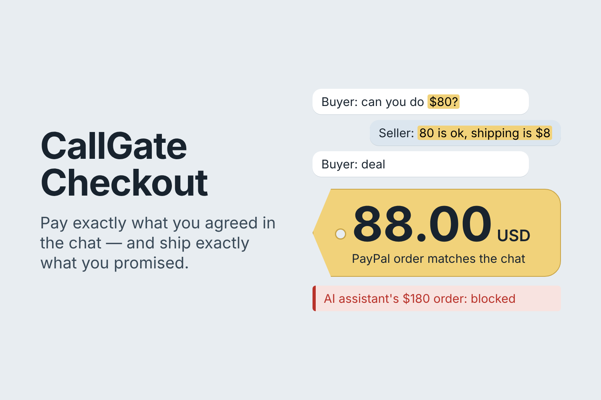
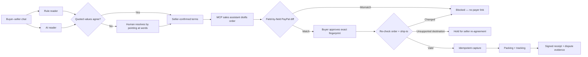

<div align="center">

# CallGate Checkout

### Pay what the chat agreed. Ship what the seller promised.

An AI-assisted PayPal checkout that grounds every amount in the conversation,
blocks changed orders, checks the PayPal ship-to address, and preserves a
signed evidence trail from agreement to delivery.

<p>
  <a href="https://github.com/Cyberchopin/callgate-alexa-mcp/actions/workflows/test.yml"></a>
  <a href="https://github.com/Cyberchopin/callgate-alexa-mcp/actions/workflows/pip-audit.yml"></a>
  <a href="LICENSE"></a>
  
  
</p>

**[Demo](#demo-in-60-seconds)** · **[How it works](#how-it-works)** ·
**[Verified evidence](#verified-evidence)** · **[Run locally](#run-locally)** ·
**[Submission pack](#submission-pack)**



</div>

---

Resale deals are negotiated in chat, but the payment link is created somewhere
else. A seller may agree to **$80 + $8 shipping**, while an assistant drafts
**$180**. A buyer may ask for delivery to a cousin, but PayPal Seller Protection
depends on shipping to the address attached to the transaction. When the chat,
the order, and the parcel are disconnected, both sides lose the evidence they
need.

CallGate Checkout keeps those stages connected:

| 💬 Ground the deal | 🛡️ Gate the action | 🧾 Preserve the proof |
| --- | --- | --- |
| A rule reader and an AI reader quote the exact chat lines behind price, shipping, currency, and acceptance | Deterministic code compares the drafted PayPal order with the seller-confirmed terms before any payer link can be used | Signed offer, scoped payer approval, capture, packing evidence, tracking, and provenance remain linked |

> **Design rule:** AI reads the messy conversation and may draft an order.
> Deterministic code and explicit human confirmation decide whether money or a
> parcel can move.

## Demo in 60 seconds

1. Paste a bilingual resale chat and click **Read the agreement**.
2. Inspect the agreed total beside the exact words that support it.
3. Let the AI sales assistant draft an order. A planted **$180** instruction is
   rejected because it does not match the confirmed **$88** deal.
4. Let the buyer inspect and approve the exact verified order.
5. Re-read PayPal before capture. A changed order or unsupported destination is
   blocked or held; a valid order is captured once.
6. Turn promises such as “original box included” into a packing checklist, add
   tracking, and export the signed evidence chain.

The complete under-three-minute recording plan and exact English narration are
in the **[bilingual demo script](docs/paypal/DEMO_SCRIPT.md)**.

## How it works



### Agentic commerce without agentic authority

The MCP gateway exposes only three tools:

| Tool | Agent capability | Deliberate boundary |
| --- | --- | --- |
| `read_deal` | Read quoted terms and risk flags | Cannot confirm disputed terms |
| `propose_order` | Draft a PayPal order | A mismatch receives no payer link |
| `get_checkout` | Read checkout status | Cannot approve, capture, release, or ship |

The model has no tool for seller confirmation, payer approval, hold release,
capture, or shipping. Its draft must survive the same deterministic comparison
as any externally created order.

### Reliability where money can move

- A write-ahead SQLite state machine records `CAPTURING` before PayPal is called.
- `PayPal-Request-Id`, compare-and-set transitions, and webhook deduplication
  prevent double capture across clicks, timeouts, retries, and restarts.
- If PayPal may have charged before a timeout, CallGate reads the order and
  reconciles instead of capturing again.
- A payer approval is scoped to one offer, one order fingerprint, a maximum
  amount, currency, expiry, and single-use nonce.
- Packing photos are hashed; label destination, packed weight, carrier, and
  tracking become part of the evidence record.

Read the **[technical deep dive](integrations/paypal_checkout/README.md)** for the
state machine, consent chain, provenance passport, risk checks, and API map.

## Verified evidence

| Evidence | Recorded result | Inspect |
| --- | --- | --- |
| Real PayPal sandbox run | A $180 order was blocked; the agreed $88 order was approved, its US ship-to checked, captured once, and given PayPal tracking | [Redacted sandbox record](docs/paypal/sandbox-run.json) |
| Focused checkout tests | **94 passed** | `python -m pytest tests/paypal_checkout -q` |
| Full local suite | **394 passed, 3 skipped** in the recorded release check | GitHub workflows and repository tests |
| CheckoutBench-lite | 12/13 deals exact, 1 abstained, 0 wrong totals; 0/5 no-deal chats payable; 67/67 mutations caught | [Evaluation fixtures](evaluation_paypal/scenarios.json) |
| Risk-line fixtures | 16/16 risky lines flagged; 0/12 ordinary lines falsely flagged | [Evaluation runner](evaluation_paypal/run.py) |

The benchmark chats and labels were written by the project author. They test
known patterns; they are **not** a real-world accuracy estimate or independent
evaluation. The sandbox record uses test accounts and proves one bounded API
flow, not production readiness.

## Run locally

Python 3.12 is the pinned development target.

```bash
git clone https://github.com/Cyberchopin/callgate-alexa-mcp.git
cd callgate-alexa-mcp
python -m venv .venv
source .venv/bin/activate
python -m pip install \
  -r requirements-lock.txt \
  -r integrations/alexa_mcp/requirements.txt \
  -r integrations/paypal_checkout/requirements.txt
python -m integrations.paypal_checkout.server
```

Open **http://127.0.0.1:8787** and choose **Use a risky cross-border example**.
Without credentials, the application uses its clearly labeled offline PayPal
stand-in. No real payment can occur.

<details>
<summary><strong>Run against the PayPal sandbox and enable the AI reader</strong></summary>

Create a free sandbox app and personal test account at
`developer.paypal.com`, then set credentials only in your local shell:

```bash
export PAYPAL_CLIENT_ID="..."
export PAYPAL_CLIENT_SECRET="..."
export ANTHROPIC_API_KEY="..."
export CALLGATE_DEMO=1
python -m integrations.paypal_checkout.server
```

Use sandbox credentials only. The client refuses the live PayPal host unless
`CALLGATE_ALLOW_LIVE=1` is explicitly set. Never commit `.env` files or paste
credentials into issues, recordings, screenshots, or chat.

</details>

### Reproduce the checked evidence

```bash
python -m pytest tests/paypal_checkout -q
python -m evaluation_paypal.run
python -m scripts.check_paypal_submission_pack --allow-video-placeholder
```

The real sandbox script creates test orders and waits for a person to approve
with a sandbox buyer account:

```bash
python -m scripts.paypal_sandbox_check
```

It is not needed for the ordinary offline demo and must never be pointed at the
live PayPal host.

## Security and product boundaries

- This is a hackathon prototype, not a production payment processor.
- It governs only orders routed through this checkout; it cannot inspect other
  PayPal activity.
- Risk flags explain suspicious deal patterns; they do not label a person as a
  scammer or authenticate an item.
- Signatures prove that a recorded value was not changed after signing. They do
  not prove that a receipt, photo, identity, or human judgment is true.
- Packing photos prove the photos existed before shipping, not what a parcel
  contained when it arrived.
- The offline stand-in is always labeled. Claims about PayPal API behavior are
  separated from deterministic simulator tests.

## Submission pack

| Start here | Purpose |
| --- | --- |
| **[中文总控提交手册](docs/paypal/SUBMISSION_PACK_ZH.md)** | 从环境检查、录屏、剪辑、上传到 Devpost 提交的完整顺序 |
| **[中英逐镜头脚本](docs/paypal/DEMO_SCRIPT.md)** | 每个时间点点哪里、画面出现什么、英文逐字念什么 |
| **[Devpost final copy](docs/paypal/DEVPOST.md)** | 英文项目名称、简介、完整说明、技术回答和奖项选择 |
| **[YouTube copy](docs/paypal/YOUTUBE_COPY_EN.md)** | 视频标题、简介、章节和标签 |
| **[最终检查清单](docs/paypal/FINAL_SUBMISSION_CHECKLIST_ZH.md)** | 提交前逐项勾选，避免链接、隐私、占位符和时长问题 |
| [Research sources](docs/paypal/RESEARCH.md) | PayPal rules and public reports behind each product check |
| [Pre-existing work boundary](docs/paypal/PREEXISTING_WORK.md) | What existed before the hackathon and what was added during it |

## Repository lineage

CallGate began as a voice-risk and simulated approval research prototype. The
earlier Amazon/Alexa MCP submission remains in this repository and is documented
under [`docs/amazon/`](docs/amazon/). CallGate Checkout is the PayPal + AI
hackathon application built on a narrow reusable primitive: canonical JSON and
Ed25519 signing. The competition boundary is documented explicitly rather than
presenting the entire repository as new work.

## License

[MIT](LICENSE). PayPal, Anthropic, and other third-party names and services
remain subject to their own terms and trademarks.
