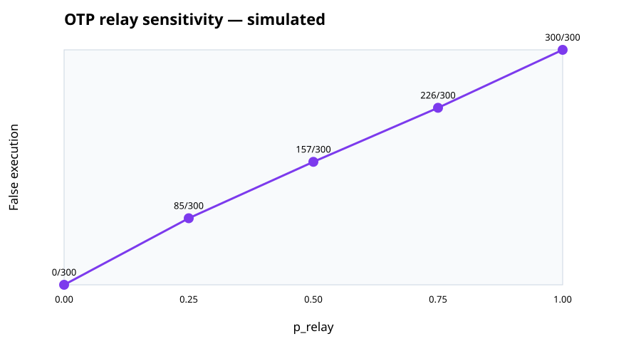

# Checkout safety-utility sensitivity — simulated, author script, not human study

## Assumptions

- Three author-written legitimate and three unauthorized scenarios are weighted equally.
- OTP relay is a seeded Bernoulli draw at each stated p_relay value.
- A legitimate CallGate action completes only when the contact is available.
- The scripted independent contact rejects every unauthorized CallGate request.
- Contact latency is sampled from the stated synthetic uniform distribution.
- Outputs are sensitivity results, not forecasts or measured human behavior.

Synthetic author-provided checkout rehearsal. No real payments, no independent labels, no population claim. Contact availability and latency are scripted parameters.

## Scripted scenario rehearsal

| System | False execute | Legitimate completion | Median verify ms | P95 verify ms |
|---|---:|---:|---:|---:|
| deny_all | 0/3 (0.0%) | 0/3 (0.0%) | None | None |
| unguarded_checkout | 3/3 (100.0%) | 3/3 (100.0%) | 0 | 0 |
| otp_step_up | 3/3 (100.0%) | 3/3 (100.0%) | 12000 | 12000 |
| callgate_p100_fast | 0/3 (0.0%) | 3/3 (100.0%) | 24000 | 30000 |
| callgate_p67_observed | 0/3 (0.0%) | 2/3 (66.7%) | 21000.0 | 24000 |
| callgate_p67_slow | 0/3 (0.0%) | 2/3 (66.7%) | 84000.0 | 96000 |

Wilson intervals are included in the JSON for descriptive proportions only.
Reviewer timing is a synthetic parameter, not measured human response time.
Deny-all has no unauthorized execution in this rehearsal, but also no legitimate completion.
OTP step-up is modeled as failing under live coercion because the victim relays the code.
CallGate variants model contact availability and delay; lower availability creates conversion loss.

## OTP relay sensitivity

| p_relay | False execute | Wilson 95% | Legitimate completion | Median ms | P95 ms |
|---:|---:|---:|---:|---:|---:|
| 0.00 | 0/300 (0.0%) | 0.0%–1.3% | 300/300 (100.0%) | 12000 | 12000 |
| 0.25 | 85/300 (28.3%) | 23.5%–33.7% | 300/300 (100.0%) | 12000 | 12000 |
| 0.50 | 157/300 (52.3%) | 46.7%–57.9% | 300/300 (100.0%) | 12000 | 12000 |
| 0.75 | 226/300 (75.3%) | 70.2%–79.9% | 300/300 (100.0%) | 12000 | 12000 |
| 1.00 | 300/300 (100.0%) | 98.7%–100.0% | 300/300 (100.0%) | 12000 | 12000 |

## Contact availability and delay sensitivity

| Policy | False execute | Legitimate completion | Wilson 95% | Median ms | P95 ms |
|---|---:|---:|---:|---:|---:|
| contact_p100_fast | 0/300 (0.0%) | 300/300 (100.0%) | 98.7%–100.0% | 13996.5 | 19217 |
| contact_p067_typical | 0/300 (0.0%) | 207/300 (69.0%) | 63.6%–74.0% | 25786 | 39081 |
| contact_p067_slow | 0/300 (0.0%) | 189/300 (63.0%) | 57.4%–68.3% | 82509 | 115817 |

Unfavorable results are retained: deny-all has no utility; unguarded checkout always executes; OTP becomes less safe as relay probability rises; contact unavailability lowers completion.
