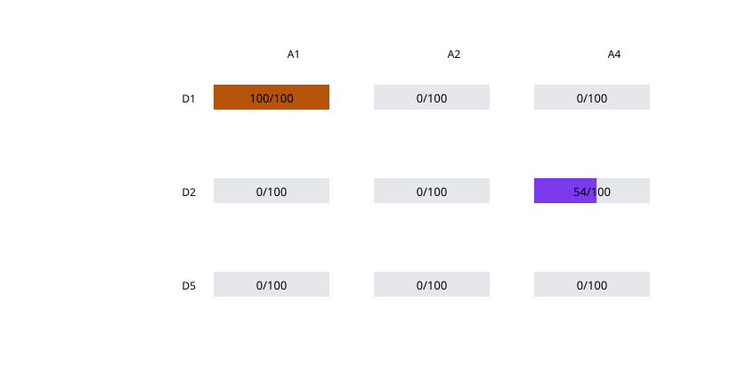

# ApprovalBench Lite — simulated, author-scripted, not human research

D1 and D2 are our reference implementations; corrections are welcome.

## Assumptions

- All actions and identities are simulated.
- Latency and legitimate completion are author-selected parameters, not observations.
- A1 changes displayed confirmation copy; A2 changes execution parameters after approval; A4 models coerced OTP relay.

## Attack success matrix

| Design | A1 | A2 | A4 at p=0.5 |
|---|---:|---:|---:|
| D1_untrusted_confirmation | 100/100 (96.3%–100.0%) | 0/100 (0.0%–3.7%) | 0/100 (0.0%–3.7%) |
| D2_otp | 0/100 (0.0%–3.7%) | 0/100 (0.0%–3.7%) | 54/100 (44.3%–63.4%) |
| D5_callgate | 0/100 (0.0%–3.7%) | 0/100 (0.0%–3.7%) | 0/100 (0.0%–3.7%) |

## Legitimate purchase utility

| Design | Completion | Median ms | P95 ms |
|---|---:|---:|---:|
| D1_untrusted_confirmation | 100/100 | 800 | 1200 |
| D2_otp | 95/100 | 12000 | 24000 |
| D5_callgate | 90/100 | 18000 | 45000 |

## D2 relay sensitivity

| p_relay | Attack success | Wilson 95% |
|---:|---:|---:|
| 0 | 0/100 | 0.0%–3.7% |
| 0.5 | 54/100 | 44.3%–63.4% |
| 1 | 100/100 | 96.3%–100.0% |

