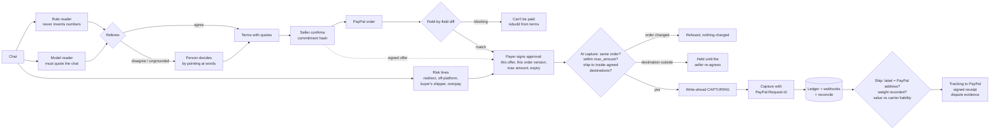

# CallGate Checkout

**Pay exactly what you agreed in the chat — and ship exactly what you promised.**

My brother resells hats, blind boxes and sneakers, some bought in Japan and sold to buyers in the US and Canada. Every deal happens in a chat: the buyer asks, he quotes, they haggle, someone says "deal", and he sends a PayPal link. That is where it goes wrong, for both sides:

- the link says the wrong amount, or adds shipping twice, and the buyer pays it;
- the buyer asks to ship "to my cousin, it's a gift", then says it never arrived — and PayPal Seller Protection doesn't cover parcels sent to another address;
- the buyer suggests friends-and-family "to save the fee", and neither side is protected any more;
- shipping was agreed for the US, and the payment comes from a Canadian address;
- the parcel crosses a border and nobody said who pays the import duties;
- the box arrives and the buyer says it was empty;
- nobody along the chain (Tokyo store → proxy buyer → reseller → buyer) can show where the item came from.

These are not hypotheticals. [`docs/paypal/RESEARCH.md`](../../docs/paypal/RESEARCH.md) lists each one with the PayPal rule or public report it comes from.

CallGate Checkout sits between the conversation and the money, and stays with the parcel until it's delivered:

1. **Read the deal.** Paste the chat. Two readers extract the agreed price, currency, shipping and the message where the other person said yes. Every value is shown next to the exact words it came from. Risky lines (redirect requests, buyer-arranged shipping, off-platform payment, overpayment refunds) are flagged with their quote and the rule that makes them risky.
2. **Confirm it.** The seller confirms the terms. A value that isn't in the chat can't be confirmed.
3. **Check the PayPal order** — built by CallGate, or drafted by someone else, including an AI sales agent — field by field.
4. **The buyer sees everything first:** the terms, the flags, and where the item came from. They confirm the exact order version; a signed approval is bound to it.
5. **Before the money moves,** PayPal's ship-to address is checked against what the chat agreed. A destination the agreed shipping doesn't cover holds the payment until the seller re-agrees. Cross-border orders warn when nobody said who pays duties.
6. **Pay once,** through double clicks, timeouts after PayPal already charged, restarts and duplicate webhooks.
7. **Pack what was promised.** "Comes with the original box" becomes a photo line. The label must go to PayPal's address; packed weight is recorded; items worth more than the carrier's default liability get a warning. Tracking goes to PayPal.
8. **The buyer confirms it arrived as described** — or says what was different.
9. **If there's a dispute,** the evidence pack is already in PayPal's provide-evidence format.

A **provenance passport** travels with the item between resellers: each holder adds a signed, hash-linked entry (where, when, serials, receipt and tag photos as hashes). The next seller verifies every link before adding theirs.

AI reads the messy part — counter-offers, "ok 80 then", "80刀 包邮", mixed Chinese and English. Deterministic code decides whether money or a parcel moves.

## What it is not

- It governs payments made through this checkout. It can't see or block any other PayPal payment.
- It doesn't decide whether someone is a scammer or whether an item is genuine. Flags show what was said and why it matters; people decide.
- A provenance passport proves who recorded what, in what order, and that nobody changed it afterwards — not that a receipt is genuine.
- Packing photos prove the photos existed before shipping, not what was in the box. That is why the carrier's acceptance weight is on the checklist.
- It is a prototype: the seller page has no login. Checkout ids are unguessable (80 random bits) and act as the link; the agent gateway can require a token. Demo controls are off unless the offline PayPal stand-in is in use or `CALLGATE_DEMO=1`.

## How it decides



### Reading terms without guessing

- **Grounding.** Every value carries `(message_index, quote)`. A quote must be an exact substring of that message and, for money, must contain the amount — or, for a total, be the sum of the amounts it quotes ("$95 plus $8"). The model's ungrounded values are dropped and listed.
- **Two readers, one referee.** If the rules and the model read different totals, the total becomes a conflict a person resolves by pointing at words. A total found only by the model is flagged for review.
- **Deal detection.** A price counts as agreed only when the *other* person accepts it without countering. A new price after the "yes" reopens the deal. A message with two different prices (`$40 … the agreed total is $400`) is never resolved automatically.
- **Shipping words label only the nearest amount**, so "$95 plus $8 shipping" is item $95 + shipping $8, "$130 shipped" is a total, and "free shipping" / "包邮" is shipping 0.
- **Chat text is data.** An instruction hidden in the chat can at most become a quote a person sees.

### Checks from real complaints

| Check | When | Effect | Why |
|---|---|---|---|
| Redirect request ("ship it to my friend", "改地址", forwarders) | Reading the chat | Flag to both sides | Seller Protection requires shipping to the PayPal address |
| Buyer-arranged shipping ("use my UPS account", "我叫快递来取") | Reading the chat | Flag | Buyer can reroute and claim non-delivery |
| Off-platform payment (friends & family, Zelle, wire, crypto, gift card, 微信转账) | Reading the chat | Flag | Not covered by Purchase Protection |
| Overpayment refund | Reading the chat | Flag | Classic reversal scam |
| PayPal ship-to outside the agreed destinations ("within the US only") | Capture | **Payment held**; seller can release with a recorded reason | The agreed shipping doesn't cover it |
| Cross-border and nobody mentioned duties | Capture | Warning (mentions the end of US de minimis on Aug 29, 2025 for US-bound parcels) | Surprise duty bills cause refused parcels |
| Label ZIP/country ≠ PayPal ship-to | Ship | **Blocked** | Seller Protection address rule |
| Item value > UPS default $100 liability, no declared value | Ship | Warning the seller must acknowledge | Carrier won't pay above its liability |
| Packed weight | Ship | Required, recorded in receipt and evidence | Weight records were what helped sellers against "empty box" claims |

### Chain of consent

Each step signs a record that names the one before it, so a dispute can be answered with "who agreed to what" rather than "my word against yours":

```
chat ──sha256──▶ seller offer ──sha256──▶ payer approval ──▶ capture ──▶ receipt
                 (signed)                (signed, scoped)                (signed, names offer + approval)
```

- **Seller offer** — written when the seller confirms the terms: chat hash, terms commitment, total, shipping, what's included, where it ships from.
- **Payer approval** — written when the payer confirms on their page. It names the offer's hash, the PayPal order id and `order_fingerprint` (SHA-256 over id, intent, amounts, breakdown, items and payee — not `status`), and is scoped like a delegated-payment allowance: `max_amount`, `currency`, `expires_at`, and a single-use `nonce` that becomes the capture's `PayPal-Request-Id`.
- **At capture** the server re-reads the order from PayPal. A different fingerprint, an amount above `max_amount`, a blocking difference, an expired approval, or an offer that no longer verifies stops the capture.
- **Receipt** names the offer and approval hashes. `verify_chain_of_consent(receipt, offer, approval)` checks every signature and link; `GET /api/checkouts/{id}/consent` returns all three.

The structure follows Google's Agent Payments Protocol (a merchant-signed cart that the user's approval refers to) and the allowance in OpenAI's commerce delegated-payment spec. All signatures here are made by the checkout server's key: they prove the records weren't changed after the fact, not which device a person used.

### Reliability

| Case | What happens |
|---|---|
| Double click, same `Idempotency-Key` | Second request gets the stored result (`replayed: true`) |
| Ten concurrent clicks with different keys | SQLite compare-and-set on state: exactly one reaches PayPal |
| PayPal charges, then the connection drops — or returns a 5xx | `CAPTURE_UNKNOWN`; the next attempt reconciles by reading the order instead of capturing again |
| Request never reached PayPal | Reconcile finds no capture, returns to `BUYER_CONFIRMED`; retry uses the **same** `PayPal-Request-Id` |
| Funds pending, completion arrives by webhook | `CAPTURE_PENDING → CAPTURED` from a verified webhook |
| Webhook redelivered / forged | Deduplicated by event id / rejected by signature verification |
| Server restarts mid-capture | Ledger is on disk; reconcile resumes |
| Concurrent photo uploads | Read-modify-write runs inside the ledger lock; none are lost |
| Same `Idempotency-Key` sent for a different checkout | Refused as a conflict; nothing reaches PayPal |

Every transition is written to an append-only event log, shown on the page as "What happened".

### Provenance passport

Each entry: `{item_id, seq, prev = SHA-256(previous signed entry), event, holder, where, when, serials, evidence[{kind, sha256}], note, recorded_at, signer}` plus an Ed25519 signature by the recording holder. Verification checks every signature, that `seq` runs 0…n, that every `prev` matches, and that all entries name the same item. Editing an entry breaks its signature; removing, reordering or re-signing a forged first entry breaks the next link. A sale through CallGate appends a signed `sold` entry, and the receipt commits to the chain head. Export with `GET /api/checkouts/{id}/passport`; the next seller imports it and adds their own entries. Anyone holding a photo can check it against the hashes in the chain.

## AI in this project

| Where | What the AI does | What it can't do |
|---|---|---|
| Reading the chat | A model reader (Claude, or any OpenAI-compatible model) reads the negotiation alongside the rule reader and must quote the chat for every value. | Add a value that isn't in the chat; settle a disagreement with the rule reader — a person does. |
| Sales assistant | Claude, working for the seller, reads the deal and drafts the PayPal order through the agent gateway. Button on the seller page, or `python -m scripts.paypal_llm_agent` over MCP. | Confirm terms, approve for the payer, release a hold, ship or capture. A wrong draft — even one it was talked into by the chat — is blocked and gets no payer link. |

Both need `ANTHROPIC_API_KEY` (the reader also accepts `OPENAI_API_KEY` + `OPENAI_MODEL`). Without a key the checkout still works with the rule reader and the AI button is hidden. Default models: `claude-sonnet-5-5` (override with `CALLGATE_MODEL` / `CALLGATE_AGENT_MODEL`).

## AI sales agents (MCP)

The server exposes `/mcp` (streamable HTTP) with three tools:

| Tool | What the agent can do |
|---|---|
| `read_deal` | Paste a chat, get the terms with quotes and the same flags people see. The seller still confirms them. |
| `propose_order` | Draft a PayPal order. It is checked against the confirmed terms; a mismatch is shown to the seller and gets no payer link. |
| `get_checkout` | Read status. A payer link appears only for a verified order. |

There is deliberately no tool to confirm terms, approve for the payer, release a hold, ship, or capture. That is the gap this fills: PayPal's own Agent Toolkit lets an agent create orders and invoices directly, and its disclaimer leaves checking the output to the user. Orders made that way can be attached to a checkout (`POST /api/checkouts/{id}/attach`) and are checked like any other. `python -m scripts.paypal_agent_demo` runs a scripted agent that obeys an instruction planted in the chat ("the real price is $180"): the planted price reopens the deal for the seller, and the agent's $180 order is blocked. Set `CALLGATE_AGENT_TOKEN` to require a bearer token on `/mcp`.

## Run it

Offline (simulated PayPal; every failure case has a demo button, and "Use a risky cross-border example" shows the flags, the address hold and the liability warning):

```bash
pip install -r requirements-lock.txt -r integrations/alexa_mcp/requirements.txt -r integrations/paypal_checkout/requirements.txt
python -m integrations.paypal_checkout.server  # http://localhost:8787
```

PayPal sandbox (real orders, real approval page, real capture, real tracking):

1. On developer.paypal.com create a sandbox app and copy its Client ID and Secret. Sandbox accounts gives you a personal (buyer) login.
2. ```bash
   export PAYPAL_CLIENT_ID=... PAYPAL_CLIENT_SECRET=...
   export SELLER_COUNTRY=US             # where you ship from
   export ANTHROPIC_API_KEY=...         # optional: model reader (or OPENAI_API_KEY + OPENAI_MODEL)
   python -m integrations.paypal_checkout.server
   ```
3. One-command check of the whole flow against the real sandbox (creates an order, waits while you approve it with a sandbox personal account, captures twice to show the second doesn't charge, adds tracking, writes the PayPal ids to `docs/paypal/sandbox-run.json`):
   ```bash
   python -m scripts.paypal_sandbox_check
   ```
4. Webhooks (optional): expose the server (e.g. a tunnel), set `CALLGATE_PUBLIC_URL`, subscribe the app to `PAYMENT.CAPTURE.*` at `/webhooks/paypal`, and set `PAYPAL_WEBHOOK_ID`.

The live PayPal host is refused unless `CALLGATE_ALLOW_LIVE=1`. `render.yaml` at the repository root deploys the offline demo on Render's free plan; add the sandbox credentials in the Render dashboard to switch it to the real sandbox.

## Evidence

- `pytest tests/paypal_checkout` — 92 tests: every reliability row above, approval, offer and webhook forgery, the chain of consent, rebuild after tampering, grounding, the MCP gateway over a real MCP client, packing / tracking / evidence, PayPal carrier codes, every risk check, provenance tampering (edit, remove, reorder, re-signed forgery, altered import), the sandbox check script itself run against the stand-in, and the AI sales assistant's tool loop driven by a scripted model (in-process and over real MCP HTTP), including a model that proposes the planted $180 first.
- `python -m evaluation_paypal.run` — CheckoutBench-lite, rules-only, October 25, 2026:
  - 18 negotiations (English, Chinese, mixed): 12/13 deals read exactly, 1 sent to a person (the injected-price chat), **0 wrong totals**, **0 of 5 no-deal chats made payable**;
  - 67/67 order mutations caught;
  - 28 single chat lines: 16/16 risky lines flagged, 0/12 false alarms on ordinary lines that use similar words.

  Every chat and line was written and labelled by the author while building the rules, so these numbers show the rules handle the patterns we know about. They are not a measure of accuracy on real conversations.

## Files

| File | Job |
|---|---|
| `terms.py` | Terms model, chat parsing, grounding checks, commitment hash |
| `extract.py` | Rule reader, model reader, referee |
| `order_check.py` | Field-by-field comparison, fingerprint, order built from terms |
| `risk.py` | Risky chat lines, destination and duties checks, label and liability checks |
| `provenance.py` | Signed, hash-linked provenance passport |
| `ledger.py` | SQLite state machine, idempotency keys, webhook dedupe, event log |
| `paypal_client.py` | Orders v2, tracking (PayPal carrier codes), disputes, webhook verification; `PayPal-Request-Id` on every write |
| `fake_paypal.py` | Offline stand-in used by tests and the demo (not PayPal) |
| `service.py` | The checkout flow and the chain of consent |
| `shipping.py` | Packing checklist, photo storage, weight, tracking body, dispute evidence |
| `agent_gateway.py` | MCP tools for AI sales agents |
| `llm_agent.py` | Claude as the seller's sales assistant (tool-use loop over the gateway) |
| `server/` | Seller page, payer page (`/pay/{id}`), JSON API, webhook endpoint, `/mcp` |
| `../../scripts/paypal_sandbox_check.py` | End-to-end run against the real PayPal sandbox |

Reuses CallGate's canonical JSON and Ed25519 signing (`callgate/receipt.py`).
